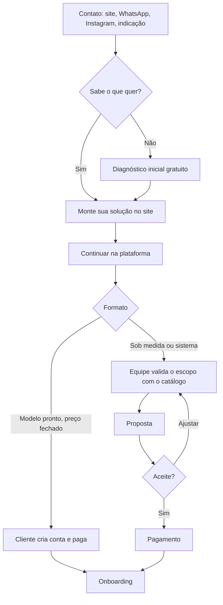

# Fluxo comercial

Do primeiro contato ao pagamento. As etapas 1 a 4 já existem no site e na plataforma; responsáveis e prazos de resposta ficam em [Equipe e papéis](../01-Empresa/Equipe%20e%20pap%C3%A9is.md).

## Etapas

| # | Etapa | O que acontece | Saída |
|---|---|---|---|
| 1 | Contato | Pelo diagnóstico da home, pelo [Monte sua solução](https://www.cmkcogit.com.br/monte-sua-solucao.html), WhatsApp, e-mail, redes ou indicação | Lead registrado |
| 2 | [Diagnóstico inicial](../03-Servicos/Diagn%C3%B3stico%20inicial.md) | Reunião gratuita: negócio, problema, objetivo. Usar as perguntas de briefing da nota do serviço | Solução e formato recomendados |
| 3 | Montagem da solução | O cliente monta no site, ou a equipe monta com o [catálogo](../04-Catalogo/INDEX.md). Combinações dão 10% de desconto | Seleção de serviços e adicionais |
| 4 | Plataforma | "Continuar na plataforma" abre app.cmkcogit.com.br com a seleção. O cliente entra ou cria conta | Pedido na plataforma |
| 5a | Preço fechado | Modelo pronto: o cliente paga direto (Mercado Pago) | Pagamento confirmado |
| 5b | Validação do escopo | Sob medida, sistemas e produtos: a equipe confere o escopo item a item ([Como precificar](../04-Catalogo/Como%20precificar.md)) | Escopo e valor final |
| 6 | Proposta | Itens, valores, repasses, recorrentes, prazo e condições ([Modelo - Orçamento](../90-Modelos/Modelo%20-%20Or%C3%A7amento.md)) | Proposta enviada |
| 7 | Aceite e pagamento | O cliente revisa tudo antes de pagar | Projeto fechado |
| 8 | [Onboarding de cliente](Onboarding%20de%20cliente.md) | Coleta de materiais e acessos | Kickoff |

## Regras comerciais que já valem

- Diagnóstico inicial gratuito.
- Consultoria e planejamento: sem custo fechando o projeto com a COGIT; R$ 350 se o cliente for desenvolver com outra empresa.
- Valores do site são valores de partida; o escopo final é confirmado na proposta.
- Todo projeto tem 1 mês de suporte gratuito.

## A definir pelos sócios

- Prazo de resposta a um novo contato.
- Validade da proposta.
- Condições de pagamento (entrada e parcelas, sinal para sob medida).
- Quem pode dar desconto e até quanto.

Related: [Como precificar](../04-Catalogo/Como%20precificar.md) · [Onboarding de cliente](Onboarding%20de%20cliente.md) · [Metodologia COGIT](Metodologia%20COGIT.md)
