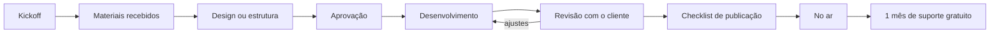

# Fluxo de entrega de projeto

Do kickoff à publicação. O número de rodadas de ajuste vem da proposta; rodadas a mais são cobradas com a [Rodada extra de ajustes](../04-Catalogo/Itens/Rodada%20extra%20de%20ajustes.md).

## Etapas

1. **Kickoff:** reunião curta para alinhar escopo, prazos, quem aprova e o que falta do [Onboarding de cliente](Onboarding%20de%20cliente.md).
2. **Design ou estrutura:** modelo pronto aplica a identidade na estrutura fixa; sob medida passa por estrutura e, se contratado, [Protótipo visual antes do desenvolvimento](../04-Catalogo/Itens/Prot%C3%B3tipo%20visual%20antes%20do%20desenvolvimento.md).
3. **Desenvolvimento.**
4. **Revisão com o cliente:** rodadas de ajuste previstas na proposta.
5. **Publicação:** checklist abaixo.
6. **Entrega:** acessos, orientação de uso e início do suporte gratuito.

## Checklist de publicação

- [ ] Domínio apontado e HTTPS ativo
- [ ] Testado em celular, tablet e computador
- [ ] Formulários e botão de WhatsApp enviando para o lugar certo
- [ ] Títulos, descrições, imagem de compartilhamento, sitemap e robots
- [ ] Métricas e pixels instalados (se contratados) e carregando só com consentimento
- [ ] Aviso de cookies e política de privacidade (se houver coleta)
- [ ] Textos revisados, sem conteúdo de exemplo
- [ ] Imagens otimizadas
- [ ] Sistemas: backup, ambiente e usuários administradores criados

## Mudou o escopo no meio?

Pedido novo durante o projeto vira item do [catálogo](../04-Catalogo/INDEX.md) somado ao orçamento, com aceite do cliente antes de fazer.

Related: [Onboarding de cliente](Onboarding%20de%20cliente.md) · [Fluxo de suporte](Fluxo%20de%20suporte.md) · [Metodologia COGIT](Metodologia%20COGIT.md)
