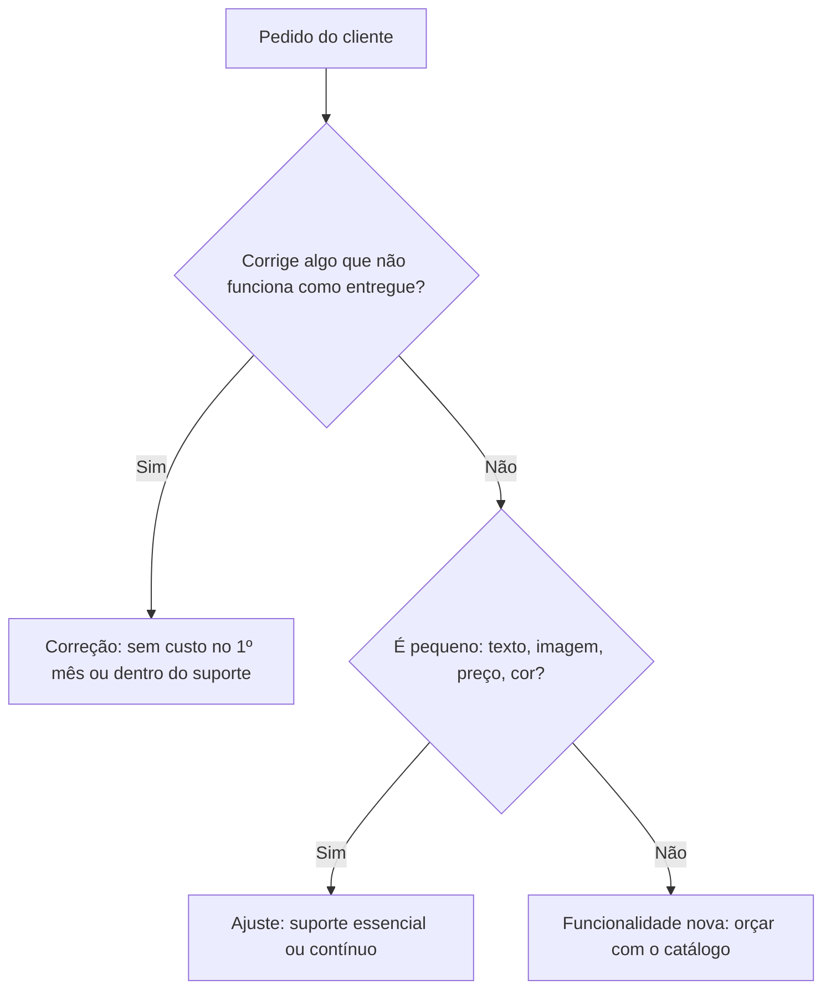

# Fluxo de suporte

Todo projeto tem **1 mês de suporte gratuito** depois da entrega. Depois, o cliente escolhe:

| Opção | Valor | Como funciona |
|---|---|---|
| [Suporte técnico essencial](../03-Servicos/Suporte%20t%C3%A9cnico%20essencial.md) | a partir de R$ 150 por solicitação | Sem mensalidade; chama quando precisar |
| [Suporte técnico contínuo](../03-Servicos/Suporte%20t%C3%A9cnico%20cont%C3%ADnuo.md) | R$ 150/mês | Mensalidade fixa com manutenção, correções e pequenos ajustes |

## Ajuste ou funcionalidade nova?

Funcionalidade nova se orça como qualquer projeto: [Como precificar](../04-Catalogo/Como%20precificar.md).

## A definir

- Prazo de resposta de cada tipo de suporte.
- Quantas solicitações cabem no suporte contínuo por mês.
- O que conta como "pequeno ajuste".

Related: [Fluxo de entrega de projeto](Fluxo%20de%20entrega%20de%20projeto.md)
