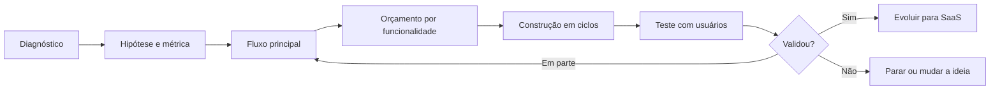

# Jornada MVP

Frente **Criar e validar**: da ideia à primeira versão testada com usuários reais, e depois ao produto completo. O orçamento é montado **por funcionalidade**, com os preços do catálogo.



## Etapas

1. **Diagnóstico** ([Diagnóstico inicial](../03-Servicos/Diagn%C3%B3stico%20inicial.md), gratuito): problema, público, por que agora.
2. **Hipótese e métrica:** o que o MVP precisa provar e qual número mostra isso (cadastros, uso semanal, primeira venda).
3. **Fluxo principal:** o caminho mínimo do usuário até o valor. Tudo o que não faz parte dele fica para depois.
4. **Orçamento por funcionalidade:** base do [MVP](../03-Servicos/MVP.md) (a partir de R$ 3.990) + cada funcionalidade escolhida no catálogo.
5. **Construção em ciclos curtos**, com entregas que o cliente testa.
6. **Teste com usuários** e leitura das métricas.
7. **Decisão:** evoluir para [Produto digital completo (SaaS)](../03-Servicos/Produto%20digital%20completo%20%28SaaS%29.md), ajustar ou parar.

## O que já está na base do MVP

- Login com e-mail e senha
- Fluxo principal
- Painel básico de gestão
- Métricas de uso para validar

## Funcionalidades para o orçamento

Use a visão **MVP** do [Catálogo.base](../04-Catalogo/Cat%C3%A1logo.base) ou a tabela da nota [MVP](../03-Servicos/MVP.md). As categorias mais usadas:

- Acesso e usuários (login social, perfis, convites, multiempresa)
- Dados e cadastros (cada cadastro é cobrado por entidade)
- Painéis e relatórios
- Comunicação e notificações
- Pagamentos e cobrança
- Módulos de negócio (agendamento, financeiro, pedidos, marketplace)
- Área de membros e cursos
- Inteligência artificial
- Integrações e infraestrutura (PWA, app nas lojas, API)

Exemplo montado em [Exemplos de orçamento](../04-Catalogo/Exemplos%20de%20or%C3%A7amento.md).

## Ligação com o orçamento MVP (sistema)

O script do catálogo exporta `_sistema/catalogo.json`. O orçamento da Jornada MVP pode ler as funcionalidades daí, sem digitar preço em dois lugares:

- use os `itens` com `"mvp"` em `servicos` (somáveis) ou em `incluso_em` (já na base);
- `id` é a chave estável; `nome`, `descricao` e `categoria` são os textos para o cliente;
- `preco` + `tipo_preco` + `unidade` dizem como calcular (por exemplo `por-unidade` com `unidade: entidade` multiplica pela quantidade);
- `status` diz se o preço já foi validado (`ativo`) ou é sugestão (`a-validar`).

Exemplo de um item no JSON:

```json
{
  "id": "acesso-login-social",
  "nome": "Login com Google ou Apple",
  "categoria": "Acesso e usuários",
  "servicos": ["sistema", "plataforma", "mvp", "saas", "loja-virtual"],
  "incluso_em": [],
  "formato": "ambos",
  "tipo_preco": "fixo",
  "preco": 450,
  "unidade": "projeto",
  "horas": 5,
  "status": "a-validar",
  "descricao": "Entrar com a conta Google ou Apple.",
  "preco_rotulo": "R$ 450"
}
```

> [!TODO] Pendência
> Conferir no repositório `mvp.cmkcogit` como o orçamento lista as funcionalidades hoje e alinhar nomes e ids com este catálogo.

Related: [MVP](../03-Servicos/MVP.md) · [Como precificar](../04-Catalogo/Como%20precificar.md) · [Metodologia COGIT](Metodologia%20COGIT.md)
